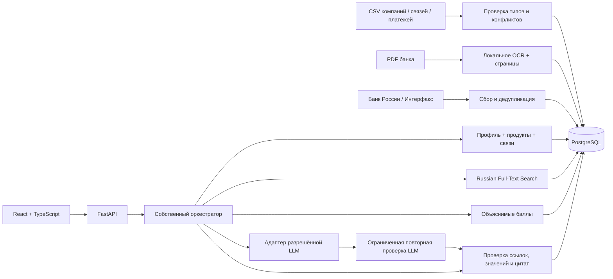

# Альфа Инсайт

Конкурсный прототип для кейса «Новостная аналитика для принятия бизнес-решений» Альфа Хакатона 2026. Сопоставляет событие с отраслью, географией, продуктами, ФТС и связями компании; показывает основания релевантности, условные риски и направления проверки, фрагменты аналитики банка и журнал инструментов.

**Дедлайн со слов участника: 26 октября 2026 года. Точное время и часовой пояс сдачи не сообщены.**

**Текущая версия работает локально без LLM. Генеративные ответы и уточняющий диалог требуют разрешённого API организаторов. Реальная LLM не проверена. Docker Compose на ARM64 собран и запущен, отдельные PostgreSQL и приложение проходят healthcheck. Полного соответствия всем AI-критериям пока нет.**

## Быстро открыть на этой машине

Сайт: http://127.0.0.1:8000 · OpenAPI/Swagger: http://127.0.0.1:8000/api/docs

Дважды нажмите файл **`Открыть Альфа Инсайт.command`** в папке проекта: он запустит сайт в фоне и откроет браузер. Повторный запуск использует уже работающий сервер.

Либо из папки проекта:

```sh
.venv/bin/python scripts/manage_local.py start
```

Скрипт использует локальный PostgreSQL в `runtime/pgdata`, порт 55432, Python из `.venv` и установленный Node. Он применяет миграции, собирает интерфейс и запускает сайт. PostgreSQL слушает только loopback; системные службы не изменяются. API останавливается Ctrl+C, база — `./scripts/stop-database.sh`.

## Архитектура



Python 3.12, FastAPI, Pydantic, SQLAlchemy, Alembic, psycopg, PostgreSQL 14 локально / 16 в Compose; React 19, TypeScript, Vite, Lucide. Все Python-зависимости зафиксированы в `backend/requirements.lock.txt`, frontend — `frontend/pnpm-lock.yaml`. Tailwind и графовые библиотеки не добавлялись: интерфейс использует обычный CSS, связи — SQL. Оригиналы кейса хранятся только в исключённой из Git папке `data/private`.

## Новый компьютер: локальная установка

Нужны Python 3.12, Node 22+, pnpm 11.25.0, PostgreSQL с `initdb`, `pg_ctl`, `pg_config`.

```sh
python3.12 -m venv .venv
.venv/bin/python -m pip install -r backend/requirements.lock.txt
cp .env.example .env
cd frontend
corepack pnpm install --frozen-lockfile
cd ..
./scripts/start-local.sh
```

Скрипт автоматизирует локальную базу на macOS/Linux при наличии PostgreSQL в PATH. В окружении Codex он также находит встроенные Node/Python. Порт 8000 должен быть свободен. `.env` может переопределять DATABASE_URL; автоматический запуск базы относится к локальной конфигурации по умолчанию.

Для разработки интерфейса, при работающем API:

```sh
cd frontend
corepack pnpm dev
```

Интерфейс разработчика: http://127.0.0.1:5173, прокси `/api` ведёт на порт 8000. При обычном запуске FastAPI раздаёт собранный интерфейс, отдельный Node-сервер не требуется.

## Docker Compose

```sh
cp .env.example .env
docker compose up --build
```

Открыть http://127.0.0.1:8000. Compose запускает PostgreSQL, ожидает healthcheck, применяет миграции, создаёт синтетические данные при старте API. База и приложение не открыты внешней сети. Используются многоархитектурные базовые образы, локальный GPU не требуется. **25 октября 2026 проверены ARM64-сборка, запуск, миграции, HTTP-сценарий и 6 E2E desktop/mobile на отдельной пустой базе. Два E2E официальных данных исключены из контейнерного прогона: набор остаётся на локальном стенде.**

Для другого локального порта: `APP_PORT=18081 docker compose up --build -d`. PostgreSQL наружу не публикуется.

Импорт скачанных официальных данных в контейнер:

```sh
docker compose exec app python scripts/import_data.py --directory data/private --pdf
```

Docker использует локальный Tesseract `rus+eng`; папка источников монтируется только для чтения. Архив источников не попадает в образ.

## Демонстрационные роли и доступ

Это токены конкурсного стенда, а не банковские аккаунты:

| Доступ | Токен по умолчанию | Данные |
|---|---|---|
| Демонстрационный | без токена или `alfa-local-demo` | Три синтетических компании |
| Локальный администратор | `alfa-local-admin` | Официальные обезличенные профили, документы, импорт |

В интерфейсе откройте **«Настройки стенда»**, введите токен администратора, нажмите **«Открыть данные кейса»**. Токен хранится только в sessionStorage текущей вкладки. Для API передавайте `Authorization: Bearer <token>`.

Четыре роли аналитики: финансовый директор, казначейство, генеральный директор, главный бухгалтер. Они меняют приоритеты ленты. Они не являются полноценной системой корпоративных пользователей или SSO. Демо-пользователь имеет право на все три синтетические компании и не имеет права на официальные профили. Оригинальные профили и их анализы проверяются на каждом запросе.

При любом внешнем размещении заменить токены и пароль PostgreSQL, отключить анонимный доступ (`DEMO_MODE=false`), добавить полноценный вход и политику доступа; см. `docs/deployment.md`.

## Получение и импорт исходных данных

Официальные публичные папки:

- Датасеты: https://drive.google.com/drive/folders/1Ep8wWoEHTg5Q8kwrLx2j_xFyxGUEVxFq
- Аналитика: https://drive.google.com/drive/folders/15xZTLF1lZ65p6o5xpNA_fRbxjoV-UlG1

```sh
.venv/bin/python scripts/download_official.py
.venv/bin/python scripts/import_data.py --directory data/private --pdf
```

Скрипт загрузки использует публичные ссылки файлов из папок кейса, не обходит вход или CAPTCHA. В `data/private/manifest.json` сохраняются URL и SHA-256. Если Google изменит доступ, используйте разрешённое ручное скачивание в эту папку. Для небольших файлов доступен импорт в настройках интерфейса, лимит 12 МБ; крупные CSV импортировать CLI.

Сканированные PDF: Linux/Docker — Tesseract с `rus+eng`; macOS — локальный Vision. Для этой машины:

```sh
swiftc -module-cache-path runtime/swift-cache scripts/ocr_macos.swift -o runtime/ocr_macos
```

OCR извлекает текст без внешнего AI-сервиса. Фрагменты сохраняют `document_id`, страницу, текст, метод извлечения, URL и стабильный ID. Распознавание может ошибаться; интерфейс предлагает сверять цитаты с оригиналом.

Уже обработано: **85 514 официальных профилей, 12 514 связей физических лиц, 1 380 584 различных платёжных строк и 9 PDF (64 страницы, 172 фрагмента)**. Дополнительно загружаются 3 синтетические компании, 2 связи и 2 платежа. Подробные отчёты качества: `docs/data-report.md`, локальные отчёты `runtime/import-v3.log`, `data/private/manifest.json`.

Повторный импорт неизменного файла пропускается по SHA-256 и версии pipeline. Изменённые строки upsert-ятся по идентификатору. Это **не синхронизация удалений**: исчезновение строки из нового файла не удаляет её из базы. Противоречивые повторы компании сохраняются в `data_issues`; основной профиль использует первое появление. Различающиеся платежи одной пары сохраняются отдельно, точные дубли убираются. Отсутствующие профили контрагентов не выдумываются.

## Работа с новостями

Кнопка «Обновить» запрашивает RSS Банка России и Интерфакса, обрабатывает до 30 записей из каждого источника. На этой машине проверены оба источника. Хранятся заголовок, текст/анонс RSS, URL, источник, дата публикации и получения, категория и извлечённые предложения. Это не всегда полный текст публикации; он доступен через ручную загрузку разрешённого URL.

Ручной ввод: текст от 30 символов и заголовок от 5, либо HTTPS URL одного из подключённых хостов. Текст не верифицируется автоматически и отмечается соответствующим образом. При отсутствии даты ручного события используется время добавления. Дедупликация — нормализованный заголовок и канонический URL; полноценная семантическая кластеризация не реализована.

Синтетические учебные события имеют заметную отметку. Историческое событие ставки из банковского PDF помечено «Архив · 11 сентября 2026», не объявляется текущим решением ЦБ.

## Разрешённая LLM

Сейчас `LLM_MODE=disabled`: все показанные правила и инструментальные действия выполняются на самом деле; генеративные ответы не имитируются. `TestProvider` используется только в тестах с явной меткой `test`.

Генеративный контур выполняет черновик и один запрос проверки/исправления. Каждый окончательный вывод требует проверяемой точной цитаты; позиция банка — цитаты банковского документа. Оба запроса учитываются в бюджете. Цитата не заменяет экспертную оценку смысла.

Подробное подключение: **`docs/llm-setup.md`**. Нужны подтверждённые организаторами API URL, протокол, точный model ID, имя разрешённой модели, ключ и тарифы. Изменение конфигурации не доказывает работоспособность интеграции: нужен реальный проверочный вызов. Код не угадывает эти параметры.

## Проверка

```sh
PYTHONPATH=backend .venv/bin/python -m pytest backend/tests -q
cd frontend
corepack pnpm build
# Если нет браузера Playwright:
corepack pnpm exec playwright install chromium
corepack pnpm test:e2e
```

Итоговая локальная проверка 25 октября: 47 backend-тестов и 8 E2E desktop/mobile прошли; TypeScript/Vite, миграции с нуля и HTTP smoke проходят. Подробности — `docs/verification.md`.

На этой машине вместо скачивания браузера использован установленный Chrome:

```sh
cd frontend
PLAYWRIGHT_CHROMIUM_EXECUTABLE_PATH='/Applications/Google Chrome.app/Contents/MacOS/Google Chrome' corepack pnpm test:e2e
```

Backend-тесты создают отдельные временные схемы в локальном PostgreSQL и удаляют **только их** после проверки. Они не очищают рабочие данные. Браузерные тесты создают явно учебные новости на локальном стенде; это ожидаемые тестовые записи. Отчёты в `runtime/pytest.xml` и `runtime/playwright-results.json`. Короткая проверка официального сценария: `.venv/bin/python scripts/verify_official.py` (добавляет обозначенное архивное событие, если оно отсутствует).

## Защита за 3–5 минут

1. Откройте обзор, покажите связь события с бизнес-контекстом и честную отметку «Анализ по правилам».
2. Включите официальный доступ, выберите U_9250: кредитный и лизинговый продукты.
3. Найдите «Архив · 11 сентября 2026», откройте разбор. Покажите 6 блоков, признаки, фрагменты банка и страницы, источники, выполненные инструменты.
4. Закройте разбор, выберите U_57706, найдите то же событие: депозитный и лизинговый контекст. Сравните основания, не только числовой балл.
5. Добавьте новую новость текстом, откройте результат и журнал, перейдите к источникам.
6. Объясните оставшуюся зависимость от разрешённой LLM и покажите отдельную вкладку метрик.

Детальный сценарий: `docs/demo-script.md`. Матрица критериев и ограничений: `docs/criteria-compliance.md`.

## Ограничения

- Реальная LLM, генеративный диалог, глубокая смысловая интерпретация и качество её связи с банковской экспертизой не проверены без API. Условные правила не заменяют этот критерий.
- Проверка ссылок и чисел не доказывает смысловую поддержку всех утверждений; требуется экспертная оценка.
- Docker ARM64 проверен. Постоянный внешний хостинг не настроен; временное демо и его актуальное состояние описаны в `docs/deployment.md`.
- В официальных CSV есть неполные и конфликтующие сведения. Единица выручки и период платежей не уточнены в кейсе; денежное влияние, текущая задолженность и рыночная доля не выводятся.
- Поиск ленты ограничен 500 последними сохранёнными событиями, выдача — 100; связи — до 12 крупнейших строк и найденных групповых/личных связей. Расчёт по правилам и SQL реализован без промышленной нагрузочной проверки.
- Анализ запускается синхронно с лимитом времени, состояние и результаты сохраняются; очереди фоновых заданий и WebSocket не добавлены.
- Безопасная загрузка ограничена списком хостов, HTTPS, публичными IP и 2 МБ; redirects отключены. Для внешнего production нужен outbound proxy с закреплением IP против DNS rebinding.
- Демо-токены предназначены для loopback, не заменяют промышленную аутентификацию.
- Права на публичное распространение официального набора и банковских обзоров не подтверждены. Их нет в Git/образе.

Схема и безопасность: `docs/architecture.md`. Подготовка внешнего стенда: `docs/deployment.md`. Сторонние компоненты: `THIRD_PARTY_NOTICES`. Состояние разработки: `PROGRESS.md`.

## Сдача

Приватный репозиторий: https://github.com/mariapiskun/alfa-insight-hackathon-2026. Финальная версия — тег `v0.2.0-submission`; ранний `v0.1.0-demo` сохранён. Автопроверка: GitHub Actions. Доступ жюри `alfa-hack-2026` ещё не выдан: запрос приглашения отклонён пользователем в окне разрешений.

После фиксации версии команда `.venv/bin/python scripts/package_submission.py` создаёт `submission/alfa-insight-source.zip`, `submission/alfa-insight-history.bundle` и manifest SHA-256. Официальные данные, ключи и окружение в пакет не входят. Краткая памятка — `СДАЧА.md`.
